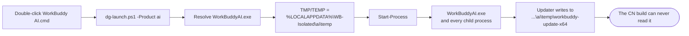

# DualGuard

[简体中文](README.md) · **English**

**Making the Chinese and international builds of WorkBuddy coexist on one Windows machine.**

A pure-script, process-level isolation scheme: no program files are modified, nothing is written to `HKLM`, and no administrator rights are needed. Delete two directories and you are fully rolled back.

`Windows 10 / 11` · `PowerShell 5.1` · `no admin required` · `MIT`

---

## The problem it solves

Installing both the Chinese build (WorkBuddy, `www.workbuddy.cn`) and the international build (WorkBuddy AI, `www.workbuddy.ai`) on the same machine produces **two-way interference**:

- Updating either build force-closes the other one
- Worse: after an update the other build's executable is gone and both shortcuts launch the same app
- The update also risks wiping the other build's session history and sign-in state

This is not folklore. There are two concrete causes.

**Cause 1 — a shared update cache.** Both clients write to `workbuddy-update-x64*` under `%TEMP%`. An installer downloaded by one build sits there, and the other build may "recover" it as its own pending update and run it — with no idea whose installer it actually is.

**Cause 2 — updates are full re-installs.** An update is not a patch. It is *download the complete installer → silent uninstall → reinstall*. Any modification you make to the program files is therefore replaced wholesale on the next update.

> Conclusion: **editing program files is pointless. The only thing you can change is the runtime environment.**

---

## How it works: one process-level environment variable rewrite

`TEMP` is a per-process environment variable, and child processes inherit the parent's environment block. So if you change it **before** the `exe` is launched, that process — and every updater or downloader it spawns — can no longer see the shared cache directory.



The change happens only inside the **current process's environment block**: system environment variables are untouched, the registry is untouched, the install directory is untouched. It disappears when the process exits.

---

## Files

| File | Purpose |
|---|---|
| `DualGuard.cmd` | **Main entry point**, opens the maintenance menu |
| `WorkBuddy CN.cmd` | Launches the Chinese build with an isolated TEMP |
| `WorkBuddy AI.cmd` | Launches the international build with an isolated TEMP (**the autostart entry points here**) |
| `dg-launch.ps1` | Launcher: resolve the exe path → create the isolated TEMP → inject `TMP`/`TEMP` → start the process |
| `dg-menu.ps1` | Maintenance menu: status diagnostics, snapshots, cache cleanup, freeze/unfreeze |
| `README.md` | Chinese version of this document |
| `README.en.md` | This file |

**This directory holds static files only. It produces no runtime artifacts and stores no history.** Logs and snapshots all go to `%LOCALAPPDATA%\DualGuard\`, which means the whole directory can be copied, archived, or even made read-only.

> Do not delete `dg-launch.ps1`: both launch `.cmd` files and the autostart entry depend on it.

---

## Quick start

**Order matters: configure first, launch afterwards.**

There is exactly one reason. Both freezing and cache cleanup require the clients to be **not running**. During first-time setup neither client has been started yet, so that condition is satisfied for free. If you launch first and configure later, you have to fully quit both builds just to continue — a detour for nothing.

### First-time setup (3 steps)

1. Put the directory anywhere — spaces and non-ASCII characters in the path are fine, because the scripts locate themselves via `%~dp0` / `$PSScriptRoot`
2. **Double-click `DualGuard.cmd`** and do three things in order:
   - Choose `5` to freeze auto-updates
   - Choose `3` to create the first snapshot and clean the shared cache (you must type `yes` at the end; if this machine has never run a client and the data directories are empty, an empty snapshot is normal)
   - Choose `0` to exit
3. **Only now launch both builds** with `WorkBuddy CN.cmd` and `WorkBuddy AI.cmd` (the isolated directories are created automatically on first run)

Isolation is now in effect, and you already have a clean backup.

### Day-to-day

| Task | Action |
|---|---|
| Launch | Double-click `WorkBuddy CN.cmd` / `WorkBuddy AI.cmd` |
| Update | `DualGuard.cmd` → `4` to unfreeze → quit the *other* build → install via the in-app prompt → `5` to freeze again |
| Autostart (optional) | Point the relevant value under `HKCU\Software\Microsoft\Windows\CurrentVersion\Run` at the **full path** of `WorkBuddy AI.cmd` (quotes required) |

> Old `WorkBuddy.lnk` shortcuts on the desktop or Start menu still target the `exe` directly and will bypass the isolation. Delete them and instead right-click the `.cmd` → *Send to* → *Desktop (create shortcut)*.

---

## The maintenance menu

Double-click `DualGuard.cmd`:

```
========================================================
  DualGuard   WorkBuddy dual-build isolation & maintenance
========================================================

== Status ==
  CN build  D:\workbuddy\WorkBuddy.exe
            version 5.9.2   endpoint https://www.workbuddy.cn
  AI build  F:\WorkBuddyAI\WorkBuddyAI.exe
            version 5.8.4   endpoint https://www.workbuddy.ai
  Processes: neither build running  [OK]
  Auto-update: frozen (both sides)
  Autostart: WorkBuddy.WorkBuddyAI = "C:\Tools\DualGuard\WorkBuddy AI.cmd"
  Shared cache: no leftover installers  [OK]
========================================================
  1  Create snapshot                 requires both clients closed
  2  Clean shared update cache       requires both clients closed
  3  Run 1 + 2 in sequence           requires both clients closed, recommended
  4  Unfreeze auto-updates           re-enables in-app updates
  5  Freeze auto-updates             blocks auto-updates
  6  Refresh status
  0  Exit
========================================================
```

> The tool's own interface is Chinese-only. The transcript above is a translation; the option numbers and their behaviour are what matter.

| Option | Behaviour | Safety design |
|---|---|---|
| `1` Snapshot | Copies `~\.workbuddy`, `~\.workbuddy-ai`, `%LOCALAPPDATA%\CodeBuddyExtension` and packs them; keeps the latest 5 | Blocks until both clients have exited; excludes bulky directories such as logs and caches |
| `2` Cache cleanup | Deletes `workbuddy-update-x64*` under the system `%TEMP%` | Requires typing the full word `yes`; **any path under `WB-Isolated` is skipped unconditionally** |
| `3` Snapshot + cleanup | Runs them in "back up first, delete second" order | Same as above |
| `4` Unfreeze | Deletes the 6 placeholder files, restoring in-app updates | — |
| `5` Freeze | Creates 3 same-named empty files in each isolated TEMP | — |
| `6` Refresh | Re-reads the status block | — |

---

## Freezing and updating

**Freezing does not disable updating. It makes *unattended* updating fail.**

The mechanism: in each isolated TEMP, occupy the cache directory name with a **zero-byte file of the same name**

```
%LOCALAPPDATA%\WB-Isolated\cn\temp\workbuddy-update-x64
%LOCALAPPDATA%\WB-Isolated\cn\temp\workbuddy-update-x64-workbuddy
%LOCALAPPDATA%\WB-Isolated\cn\temp\workbuddy-update-x64-workbuddy-ai
%LOCALAPPDATA%\WB-Isolated\ai\temp\   (the same three)
```

A file occupying the name means the updater cannot create its cache directory, so the download step fails. This lock lives outside the install directory, so a reinstall will not wipe it.

> When it takes effect: the placeholders are a filesystem state and apply **immediately to processes started afterwards**. Already-running instances cannot see them — they hold the `TEMP` they received at launch. That is why "freeze first, launch second" is the only order that needs no repeated quitting of clients.

To update, follow the steps below. In-app updating keeps working normally.

### Method A: in-app update (recommended)

Precondition: the build you are updating **was launched via its `.cmd`**. Otherwise its `TEMP` is the system directory and unfreezing accomplishes nothing.

1. Double-click `DualGuard.cmd` → `4` to unfreeze (deletes the 6 placeholder files; safe at any time, does not affect running instances)
2. Fully quit the **other** build (right-click the tray icon → exit; clicking the window's × is not enough)
3. In the build being updated, click the update prompt → wait for the download → let it restart when asked
4. Double-click `DualGuard.cmd` → `6`, and confirm the version changed and the endpoints did not get crossed
5. Choose `5` to freeze again

> If step 3 does nothing, fully quit that client, relaunch it via the `.cmd`, and try again — the updater is probably still stuck in the "download failed" state from the previous attempt.

### Method B: official installer, installed over the top

1. Download the latest installer from the official site
2. Fully quit **both** builds
3. Run the installer and install to the **existing install directory** (do not let the installer pick a different path)
4. Before launching, double-click `DualGuard.cmd` → `5` to freeze again (a reinstall may not respect the freeze, so verify the status afterwards)

**You do not need to uninstall anything first.** The installer already performs a silent uninstall internally and then reinstalls — that is exactly where "full re-install" comes from.

**For extra safety:** take a snapshot before updating (`DualGuard.cmd` → `1`, both builds must be closed). If the update goes wrong, your data is still there.

---

## Data and log locations

| Content | Path |
|---|---|
| Isolated TEMP (including placeholders) | `%LOCALAPPDATA%\WB-Isolated\{cn,ai}\temp` |
| Launch log | `%LOCALAPPDATA%\DualGuard\logs\dg-launch.log` |
| Maintenance log | `%LOCALAPPDATA%\DualGuard\logs\dg-maintain.log` |
| Snapshots | `%LOCALAPPDATA%\DualGuard\snapshots\dg-yyyyMMdd-HHmmss.zip` |
| The program itself | The tool directory (static, no artifacts) |

Everything is written under your user profile, which is why **no administrator rights are required**.

---

## Verifying that isolation works

**1. Dry run (does not launch the app)**

```powershell
powershell -NoProfile -ExecutionPolicy Bypass -File .\dg-launch.ps1 -Product ai -DryRun
```

The expected output contains `iso : isolated=True`, with `temp` pointing at `WB-Isolated\ai\temp`.

**2. Look for real activity in the isolated directory**

Launch the international build via its `.cmd`, use it normally for a few minutes, then check:

```powershell
Get-ChildItem "$env:LOCALAPPDATA\WB-Isolated\ai\temp" | Select-Object Name, LastWriteTime
```

Temporary files written by the client during runtime mean that process's `TEMP` really does point here.

**3. The strongest evidence**

Trigger an update check (or wait for one), then look in the same place for a `workbuddy-update-x64` subdirectory. If it appears, the updater is genuinely using the isolated directory and the loop is closed — this is the exact moment the shared-cache conflict is severed.

---

## Scope and known limitations

**What it does achieve**

- Severs the path where one build picks up an installer from the other build's update cache
- Makes auto-updating controllable at the filesystem level, rather than relying on a UI toggle alone
- Covers the autostart entry point
- Provides a recoverable backup while installer behaviour remains out of your control

**What it does not achieve (important)**

- **It does not guarantee "absolutely no interference".** The installer is a binary; whether it terminates the other instance by process name during a silent reinstall, and whether it remembers the previous install directory, cannot be influenced from a script. This tool lowers the probability; it does not eliminate the risk.
- **Freezing rests on an empirical assumption.** It assumes the updater must first create the `workbuddy-update-x64` directory before downloading. If an unknown fourth naming variant or a fallback download path exists, the placeholders will not block it — and the only cost is a few empty files.
- **Path detection is heuristic.** The scripts locate the `exe` via a candidate list, the registry, and directory scanning. If you installed to an unusual location, edit `Find-CnExe` / `Find-AiExe` in `dg-launch.ps1` or `Get-CnExe` / `Get-AiExe` in `dg-menu.ps1`.
- **`@genieworkbuddy-desktop-updater` is unaffected by `TEMP`.** Harmless as long as both updaters are the same version; not handled.
- Requires PowerShell 5.1 (built into Windows). Behaviour under PowerShell 7 is not guaranteed.

**Operating discipline you must follow**

1. Never update both builds at the same time
2. Before updating either build, fully quit the other one
3. Always launch via the `.cmd` files, never via the old shortcuts that target the `exe` directly

---

## Rollback

| Target | Action |
|---|---|
| Autostart entry | Set `WorkBuddy.WorkBuddyAI` under `HKCU\Software\Microsoft\Windows\CurrentVersion\Run` back to its original value: the full quoted path of `WorkBuddyAI.exe` inside the international build's install directory |
| Isolated directories | Delete `%LOCALAPPDATA%\WB-Isolated` |
| Logs / snapshots | Delete `%LOCALAPPDATA%\DualGuard` |
| The program | Delete this directory |

This tool does not modify any program files, does not modify `HKLM`, and does not touch either client's data root (`~\.workbuddy` / `~\.workbuddy-ai`). Rollback leaves nothing behind.

---

## FAQ

**Q: Can changing `TEMP` break the client?**

No. `TEMP` only affects where temporary files go, and the client is already designed to tolerate a variable location (in corporate environments `TEMP` is routinely redirected).

**Q: Can I still update after freezing?**

Yes. Choose `4` in the menu to unfreeze, or install the official installer over the top — the latter is never blocked.

**Q: I only use one build. Do I need this?**

No. The shared-cache conflict only matters when both builds are installed.

**Q: Why are the launchers named `WorkBuddy CN.cmd` rather than `DualGuard CN.cmd`?**

The launchers are named after *what they launch*, so you pick the right one at a glance. The tool entry point `DualGuard.cmd` is named after *the tool*. The two naming schemes each do their own job.

**Q: Why does `dg-menu.ps1` start with a BOM?**

PowerShell 5.1 parses a BOM-less `.ps1` using the system ANSI code page, which turns Chinese text into mojibake. The `.cmd` files use ASCII only, to sidestep code-page issues entirely.

**Q: Will this lose my data?**

The tool itself only reads data and writes its own logs and snapshots. The real risk comes from the client updater, which is why snapshots exist: a snapshot from option `1` contains both data roots and the sign-in state, and can be unzipped straight back into place.

---

## License and notice

This is a third-party tool, unaffiliated with the official WorkBuddy product. It contains no client binaries and does not modify any of their program files.

Licensed under the [MIT License](LICENSE). The scripts are provided as-is; assess the risk yourself before use.
